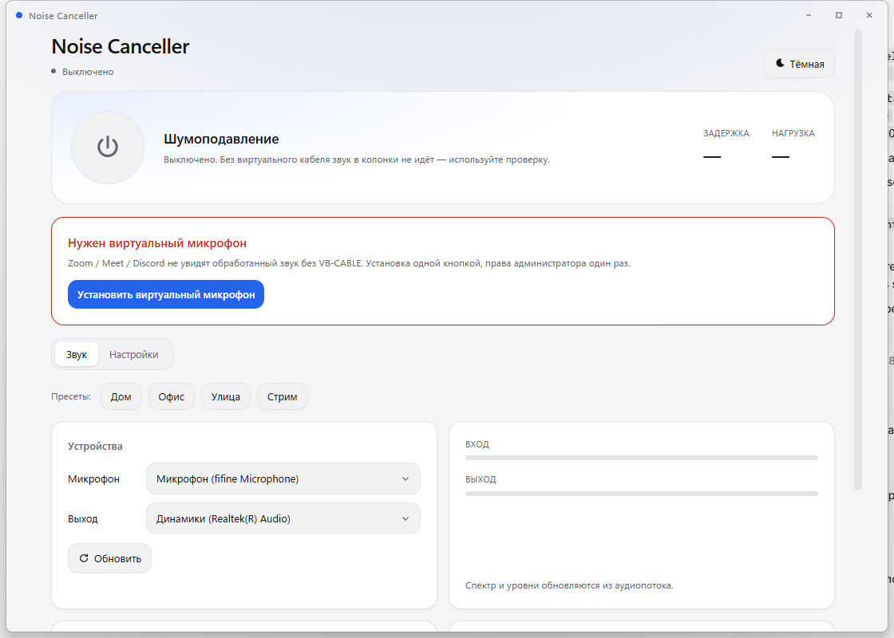

# Noise Canceller

Портативное приложение для Windows 11: подавляет шум и **убирает чужие голоса** из
микрофона, отдавая очищенный звук в Zoom, Google Meet, Discord, Telegram через
виртуальный кабель. Всё считается на устройстве, без интернета: сеть нужна только
по нажатию — проверить ревизию модели на HuggingFace и скачать установщик
VB-CABLE.



## Скачать

Готовые сборки — в [релизах](https://github.com/Venokur/noise-canceller/releases/latest):

| Файл | Что это |
|---|---|
| `noise-canceller-<версия>-setup.exe` | Установщик для текущего пользователя: ставит в `%LOCALAPPDATA%\Noise Canceller`, добавляет ярлык в «Пуск», права администратора не нужны. Профили, записи и настройки лежат в `data\` рядом с exe и при удалении сохраняются. |
| `noise-canceller-<версия>-portable.zip` | Портативная сборка: распаковать в любую папку и запустить `noise-canceller.exe`. Всё, включая `data\`, остаётся внутри этой папки. |

Установщик не подписан сертификатом, поэтому SmartScreen покажет «Неизвестный
издатель» — «Подробнее» → «Выполнить в любом случае». Контрольные суммы лежат
рядом, в `SHA256SUMS.txt`. VB-CABLE в сборку не входит: он ставится из самого
приложения и только по нажатию.

## Как пользоваться

Приложению нужен настоящий микрофон на входе и виртуальный кабель VB-CABLE на
выходе: приложение пишет очищенный звук в кабель, а Zoom, Meet, Discord и
Telegram читают его как обычный микрофон.

| Где | Что выбрать |
|---|---|
| Приложение → «Звук» → «Микрофон» | ваш настоящий микрофон: гарнитура, USB или встроенный |
| Приложение → «Звук» → «Наушники» | наушники или колонки; **только** для режима проверки |
| Приложение → «Звук» → «Выход» | `CABLE Input (VB-Audio Virtual Cable)`; выбирается сам |
| Zoom, Meet, Discord, Telegram → микрофон | `CABLE Output (VB-Audio Virtual Cable)` |
| Zoom, Meet, Discord, Telegram → динамики | ваши наушники или колонки, но не кабель |

`CABLE Input` — сторона, в которую пишет приложение, `CABLE Output` — сторона,
которую программы читают как микрофон. Названия даны со стороны кабеля, поэтому
«Output» оказывается микрофоном, а «Input» — выходом приложения.

Установка кабеля, профиль голоса, настройка программ созвона, проверка A/B и
разбор проблем — в отдельной инструкции [USAGE.md](USAGE.md).

## Что умеет

- **Изоляция голоса** моделью [VoxLock](https://huggingface.co/arbazsiddiqui/voxlock)
  (target speaker extraction, 27M параметров, 16 кГц): запоминает ваш тембр по
  15-секундной записи и пропускает только его.
- **Остаточный шумодав DPDFNet** (по умолчанию; GTCRN и UL-UNAS — варианты) после
  VoxLock и **VAD-гейт** на Silero: паузы
  закрываются по детектору речи, а не по порогу громкости.
- **Профиль голоса с оценкой качества**: речь в %, SNR, пик, клиппинг, оценка 0–100.
  Профиль помнит микрофон, на котором записан, закрепляется за ним и
  предупреждает о несовпадении.
- **Чистка сигнала**: срез низов, гейт-экспандер, AGC, тембр (две полки),
  де-эссер, «Воздух» (синтез полосы 8–16 кГц), лимитер, комфортный шум, предел
  подавления — всё настраивается вручную, изменения применяются на лету.
- **Выбор канала** стерео-интерфейса: сумма каналов с разницей фаз даёт гребёнку,
  поэтому микрофон можно слушать одним каналом.
- **Пресеты**: Дом / Офис / Улица / Стрим.
- **Проверка без драйвера**: «Проверить в наушниках» и A/B-запись (два wav: до и
  после) с метриками — громкость, паузы тише речи, самый длинный провал.
  Сырой и обработанный звук переключаются на одной позиции, без перезапуска.
- **Установка VB-CABLE одной кнопкой** с проверкой подписи.
- Спектр, метры, тёмная и светлая темы, трей, автозапуск, один экземпляр,
  глобальный mute по Ctrl+Alt+M, проверка обновлений модели.

## Стек

| Слой | Решение |
|---|---|
| Ядро | Rust: `cpal` (WASAPI), `rtrb`, собственный ресемплер и DSP |
| Модели | sherpa-onnx 2.0.1 (C API): VoxLock int8, DPDFNet/GTCRN, Silero VAD; NovaSR для «Воздуха» |
| Оболочка | Tauri 2.12.5, свой заголовок окна |
| UI | Vue 3 Composition API + TypeScript + Vite 8 + Tailwind 4 |

Модель, DSP и захват/вывод звука — в одном процессе, без прослоек.

## Сборка

```powershell
cd app
.\scripts\fetch-models.ps1          # модели (voxlock + denoise + bwe) и DLL (native)
npm.cmd install
npm.cmd run tauri build             # exe + установщик NSIS
.\scripts\package-release.ps1       # ..\release: setup.exe, portable.zip, SHA256SUMS.txt
```

`package-release.ps1` собирает оба файла релиза (`-SkipBuild` — взять уже
собранное): установщик берётся из `target\release\bundle\nsis`, портативная папка
из `..\portable`. Он же падает, если раскладка установщика (`bundle.resources`
в `src-tauri\tauri.conf.json`) и портативной сборки разошлись.

Только портативная папка и архив: `.\scripts\package-portable.ps1 -Zip`
(`-SkipBuild` нет — ему нужен готовый exe). Скрипты не трогают `data\`,
не копируют эталонные wav и остатки удалённых моделей.

Релиз публикуется workflow `.github/workflows/release.yml` по тегу:

```powershell
git tag v0.2.1
git push origin v0.2.1
```

Тег обязан совпадать с `version` в `tauri.conf.json`, иначе workflow падает до
сборки. Ручной запуск (`workflow_dispatch`) собирает те же файлы и кладёт их в
артефакты прогона, ничего не публикуя.

Портативная папка:

```
portable\
  noise-canceller.exe
  models\voxlock\     enroll.onnx, chunk_int8.onnx
  models\denoise\     gtcrn.onnx, dpdfnet4.onnx, silero_vad.onnx
  models\bwe\         novasr.onnx
  models\speaker\     campplus.onnx
  native\             sherpa-onnx-c-api.dll, onnxruntime.dll
  licenses\           тексты лицензий моделей, DLL и иконок
  LICENSE.txt         MIT для самой программы
  THIRD_PARTY_NOTICES.txt
  data\               настройки, профили, записи, журнал (создаётся само)
  README.txt
```

Установщик ставит ровно эту раскладку (без `data\` и `README.txt`) в
`%LOCALAPPDATA%\Noise Canceller`, поэтому `paths::root_dir()` находит `models`
рядом с exe, а `data\` создаётся уже при первом запуске.

Модели и DLL в `portable\` берутся из `app\models\` и `app\native\` — те же файлы,
что скачивает `fetch-models.ps1`.

## Проверка

```powershell
cd app
cargo run -p noise-canceller-cli -- selftest 80   # модель + DSP на эталонном wav
powershell -File scripts\golden.ps1               # golden-тест, падает при дрейфе
powershell -File scripts\regression.ps1 -Count 3  # последние A/B через тот же тракт
```

Ожидаемые цифры `selftest 80`: `mic 0.0534 · model 0.0417 · dsp 0.0269 · RTF 0.32`.

## Аудиотракт

```
mic 48k → 16k → выравнивание уровня → пиковый ограничитель
        → VoxLock (блок 60 мс) → GTCRN → VAD-гейт
        → 48k → [+ NovaSR 8–16 кГц, если включён «Воздух»]
        → HPF → гейт → AGC → тембр → лимитер → «CABLE Input»
```

Итоговая задержка ≈ 60–150 мс: модель (24 мс) плюс содержимое кольца (блок +
буфер, буфер при авто-режиме подбирается по пропускам). Обычный запуск требует
виртуальный кабель; в колонки звук идёт только в режиме проверки.

## Ограничения

- VoxLock работает на 16 кГц — полоса уже, чем у «сырого» микрофона.
- «Воздух» синтезирует верхнюю октаву, а не восстанавливает её: это возвращает
  естественность, но не исходные 48 кГц записи.
- Модель обучена на английской речи; на русской качество проверялось косвенно.
- Чужие голоса гасятся на 10–25 дБ, а не в абсолютный ноль.
- Нужен VB-CABLE (ставится одной кнопкой), права администратора один раз.

## Лицензии

Программа бесплатная, исходники открыты, лицензия — **MIT** (`LICENSE`):
пользуйтесь, меняйте, встраивайте, в том числе в коммерческие продукты.

Что внутри и под какой лицензией — `THIRD_PARTY_NOTICES.md`, тексты лежат в
`licenses/`:

- VoxLock — Apache-2.0 © Arbaz Siddiqui (с NOTICE);
- GTCRN — MIT © Rong Xiaobin;
- Silero VAD — MIT © Silero Team;
- NovaSR («Воздух») — Apache-2.0 © Yatharth Sharma (с NOTICE);
- 3D-Speaker CAM++ (проверка говорящего) — Apache-2.0 © ModelScope;
- sherpa-onnx — Apache-2.0 © k2-fsa;
- ONNX Runtime — MIT © Microsoft;
- cpal — Apache-2.0; Tauri — MIT/Apache-2.0; Vue — MIT; Tailwind — MIT;
- `tauri-plugin-dialog`, `tauri-plugin-fs`, `rfd` — MIT/Apache-2.0 (диалоги
  экспорта/импорта);
- Lucide (`@lucide/vue`) — ISC, включая иконку приложения.

Политика зависимостей и моделей — в [LICENSING.md](LICENSING.md). Она
проверяется автоматически: `powershell -File scripts\licenses.ps1 -Check -Policy`
в CI падает на GPL/AGPL, CC-BY-NC, `other`/`unknown` и на новый `.onnx` без
строки в `MODEL_LICENSES.json`.

**VB-CABLE** — отдельный продукт VB-Audio Software, в сборку не входит: кнопка
установки скачивает официальный архив с vb-audio.com и запускает их установщик.
Он бесплатен для личного использования (donationware); для профессионального
применения нужна лицензия VB-Audio.